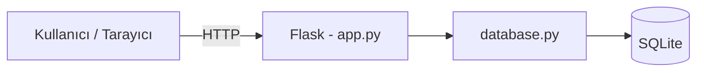
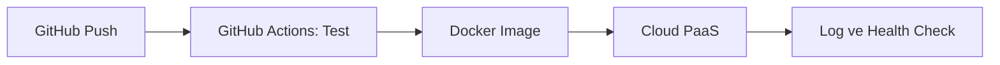

# Uygulama Mimarisi ve Veri Modeli

## 1. Genel Bakış
Öğrenci Ödev Takip Sistemi, Flask ile geliştirilmiş, SQLite veritabanı kullanan küçük ölçekli bir web uygulamasıdır.
Uygulama Docker ile paketlenip bir PaaS bulut platformunda çalıştırılacaktır.

## 2. Mimari
Uygulama 3 katmandan oluşur:

| Katman | Görev | Dosya |
|---|---|---|
| Sunum (Presentation) | HTML sayfaları, formlar | `src/templates/` |
| Uygulama (Application) | İstekleri karşılama, iş kuralları (gecikme kontrolü vb.) | `src/app.py` |
| Veri (Data) | Veritabanı bağlantısı ve sorgular | `src/database.py` |



### DevOps Akışı


## 3. Klasör Yapısı
```
odev-takip-sistemi/
├── src/
│   ├── app.py            # Flask uygulaması ve route'lar
│   ├── database.py       # SQLite bağlantısı ve sorgular
│   └── templates/        # HTML şablonları
├── tests/                # Otomatik testler (pytest)
├── docs/                 # Mimari ve proje dokümanları
├── .github/workflows/    # GitHub Actions CI/CD
├── Dockerfile
├── requirements.txt
└── README.md
```

## 4. Veri Modeli

### Tablo: `assignments` (Ödevler)

| Alan | Tip | Kural | Açıklama |
|---|---|---|---|
| id | INTEGER | PRIMARY KEY, otomatik artan | Ödev numarası |
| title | TEXT | NOT NULL | Ödev başlığı |
| course | TEXT | | Ders adı |
| description | TEXT | | Ödev açıklaması |
| due_date | DATE | NOT NULL | Teslim tarihi |
| status | TEXT | Varsayılan: "Bekliyor" | Bekliyor / Devam Ediyor / Teslim Edildi |
| created_at | DATETIME | Otomatik | Oluşturulma zamanı |

**Gecikme kuralı (F5):** `status` "Teslim Edildi" değilse;
- `due_date` bugünden önceyse → **Gecikti**
- `due_date` 3 gün içindeyse → **Yaklaşıyor**

## 5. Sayfalar ve Endpoint'ler

| Yöntem | Adres | Görev | Fonksiyon |
|---|---|---|---|
| GET | `/` | Ödevleri listele (`?status=` ile filtre) | F2, F5 |
| GET, POST | `/add` | Yeni ödev ekle | F1 |
| POST | `/status/<id>` | Durumu güncelle | F3 |
| GET, POST | `/edit/<id>` | Ödevi düzenle | F4 |
| POST | `/delete/<id>` | Ödevi sil | F4 |
| GET | `/health` | Uygulama sağlık kontrolü (monitoring) | DevOps |
