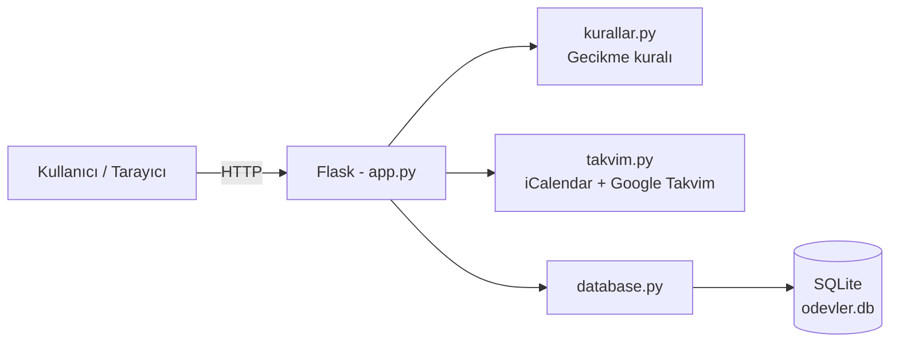
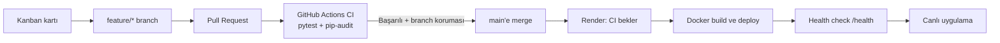

# Uygulama Mimarisi ve Veri Modeli

## 1. Genel Bakış
**Öğrenci Ödev Takip Sistemi**, öğrencilerin ödevlerini ve teslim tarihlerini yönetebildiği küçük ölçekli bir web uygulamasıdır.
Flask (Python) ile geliştirilmiş, SQLite veritabanı kullanır; Docker ile paketlenip **Render** PaaS platformunda çalıştırılır.

| Bileşen | Teknoloji |
|---|---|
| Backend | Python 3.12, Flask 3 |
| Veritabanı | SQLite (tek dosya) |
| Üretim sunucusu | gunicorn |
| Test | pytest (22 test) |
| CI | GitHub Actions (test + pip-audit güvenlik taraması) |
| Container | Docker (python:3.12-slim) |
| Cloud / CD | Render (Frankfurt), Auto-Deploy: After CI Checks Pass |

## 2. Katmanlı Mimari
Uygulama sorumlulukları ayrılmış katmanlardan oluşur. `app.py` veritabanına doğrudan SQL yazmaz; tüm veri işlemleri `database.py` üzerinden yapılır.

| Katman | Görev | Dosya |
|---|---|---|
| Sunum (Presentation) | HTML sayfaları ve formlar (Jinja2 şablonları) | `src/templates/` |
| Uygulama (Application) | İstekleri karşılama, doğrulama, yönlendirme, loglama, güvenlik başlıkları | `src/app.py` |
| İş Kuralları (Domain) | Gecikme / yaklaşma kuralı (F5), takvim üretimi (F6) | `src/kurallar.py`, `src/takvim.py` |
| Veri (Data) | SQLite bağlantısı ve sorgular | `src/database.py` |



İş kuralları (`kurallar.py`, `takvim.py`) Flask'tan bağımsız **saf fonksiyonlar** olarak yazılmıştır. Tarih gibi değişken girdiler parametreyle verilebildiği için birim testleri her gün aynı sonucu verir.

## 3. Klasör Yapısı
```
odev-takip-sistemi/
├── src/
│   ├── app.py              # Flask uygulaması, route'lar, loglama, güvenlik başlıkları
│   ├── database.py         # SQLite bağlantısı ve sorgular
│   ├── kurallar.py         # F5: Gecikti / Yaklaşıyor kuralı
│   ├── takvim.py           # F6: iCalendar (.ics) ve Google Takvim bağlantısı
│   └── templates/          # base, index, add, takvim HTML şablonları
├── tests/
│   ├── test_app.py         # Route / entegrasyon testleri (geçici veritabanı ile)
│   ├── test_kurallar.py    # F5 birim testleri
│   └── test_takvim.py      # F6 birim testleri
├── docs/architecture.md    # Bu doküman
├── .github/workflows/ci.yml  # CI: pytest + pip-audit
├── Dockerfile
├── .dockerignore
├── pytest.ini
├── requirements.txt
└── README.md
```

## 4. Veri Modeli

### Tablo: `assignments` (Ödevler)

| Alan | Tip | Kural | Açıklama |
|---|---|---|---|
| id | INTEGER | PRIMARY KEY, otomatik artan | Ödev numarası |
| title | TEXT | NOT NULL | Ödev başlığı |
| course | TEXT | | Ders adı |
| description | TEXT | | Ödev açıklaması |
| due_date | DATE | NOT NULL | Teslim tarihi (YYYY-AA-GG) |
| status | TEXT | Varsayılan: "Bekliyor" | Bekliyor / Devam Ediyor / Teslim Edildi |
| created_at | DATETIME | Otomatik | Oluşturulma zamanı |

**Gecikme kuralı (F5):** `status` "Teslim Edildi" değilse;
- `due_date` bugünden önceyse → **Gecikti**
- `due_date` 3 gün içindeyse → **Yaklaşıyor**

**Takvim kuralı (F6):** "Teslim Edildi" olmayan her ödev, teslim gününde tüm gün süren bir etkinlik olur; teslimden önceki gün 09:00'da hatırlatma (`TRIGGER:-PT15H`) içerir.

Sorgularda kullanıcı verisi `?` yer tutucularıyla aktarılır (**SQL Injection koruması**).

## 5. Sayfalar ve Endpoint'ler

| Yöntem | Adres | Görev | Fonksiyon |
|---|---|---|---|
| GET | `/` | Ödevleri listele (`?status=` ile filtre) | F2, F3, F5 |
| GET, POST | `/add` | Yeni ödev ekle (doğrulama, hatada 400) | F1 |
| POST | `/status/<id>` | Durumu güncelle (filtre korunur) | F3 |
| GET, POST | `/edit/<id>` | Ödevi düzenle (yoksa 404) | F4 |
| POST | `/delete/<id>` | Ödevi sil (onaylı) | F4 |
| GET | `/takvim` | Takvime aktarma rehber sayfası | F6 |
| GET | `/takvim.ics` | iCalendar dosyası indirme | F6 |
| GET | `/health` | Uygulama + veritabanı sağlık kontrolü (arızada 503) | Monitoring |

## 6. DevOps Akışı (CI/CD)



- **Branch koruması:** `main`'e yalnızca PR ile ve `Testleri Çalıştır` check'i geçtikten sonra merge yapılabilir.
- **CD:** Render, `main`'deki her yeni commit için CI sonucunu bekler; testler geçerse otomatik deploy eder, kalırsa canlı sürüm değişmez.

## 7. Çalışma Ortamları

| Ortam | Çalıştırma | Veritabanı (`DB_PATH`) | Kalıcılık |
|---|---|---|---|
| Yerel geliştirme | `python src/app.py` | `src/odevler.db` | Kalıcı |
| Docker (yerel) | `docker run ... -v odev-veri:/app/data` | `/app/data/odevler.db` | Volume ile kalıcı |
| Render (canlı) | Dockerfile → gunicorn | `/app/data/odevler.db` | Geçici (bkz. §10) |

Yapılandırma ortam değişkenleriyle yapılır: `DB_PATH`, `PORT`, `SECRET_KEY`, `TZ=Europe/Istanbul`.

## 8. Güvenlik
- `SECRET_KEY` koda yazılmaz; Render'da ortam değişkeni olarak tutulur
- Canlıda debug kapalı (gunicorn); container root olmayan `appuser` ile çalışır
- Güvenlik başlıkları: `X-Frame-Options: DENY`, `X-Content-Type-Options: nosniff`, `Referrer-Policy`
- İstek boyutu sınırı 16 KB (aşan istek → 413)
- Bağımlılık açığı taraması: CI'da `pip-audit`, GitHub'da Dependabot
- Gizli bilgi taraması: GitHub Secret Protection + Push protection

## 9. İzleme ve Loglama
- Python `logging` ile zaman damgalı, seviyeli loglar (INFO / WARNING / ERROR) stdout'a yazılır; Render Logs panelinden aranıp filtrelenebilir
- gunicorn erişim logları her isteği kaydeder
- `/health` Render tarafından düzenli kontrol edilir; veritabanına erişilemezse 503 döner
- Kaynak kullanımı: Render Metrics ve yerelde `docker stats` (~53 MB bellek, ~%1–2 CPU)

## 10. Bilinen Sınırlamalar
- Render ücretsiz katmanında dosya sistemi geçicidir; SQLite verileri yeniden başlatma / deploy / uyku modunda sıfırlanır. Kalıcı veri için kalıcı disk veya yönetilen PostgreSQL kullanılabilir; veri erişimi `database.py`'de toplandığı için geçiş kolaydır.
- Ücretsiz servis 15 dakika istek almazsa uyur; ilk istek ~1 dakika sürebilir.
- Teslim tarihi için makul yıl aralığı doğrulaması henüz yoktur (ileride eklenebilir).